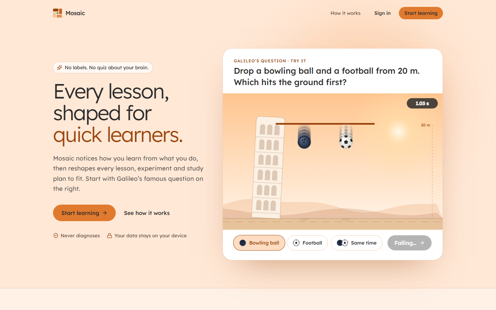
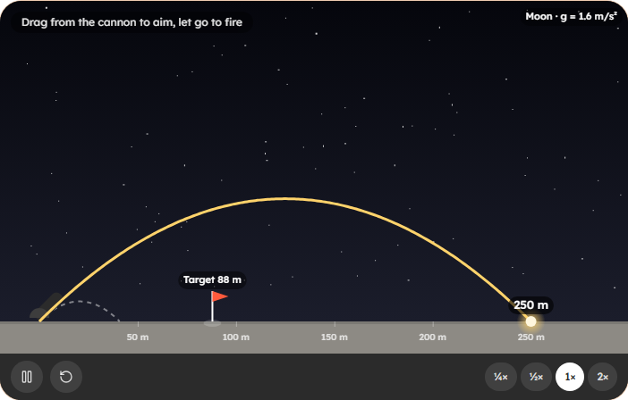
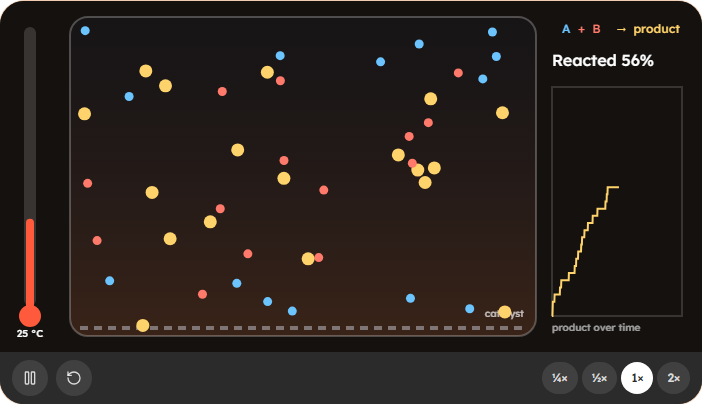
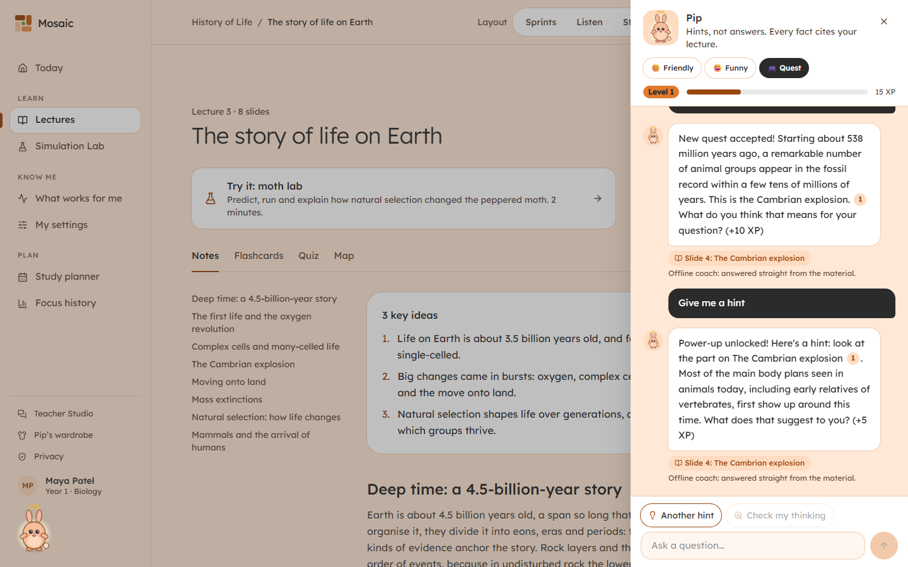
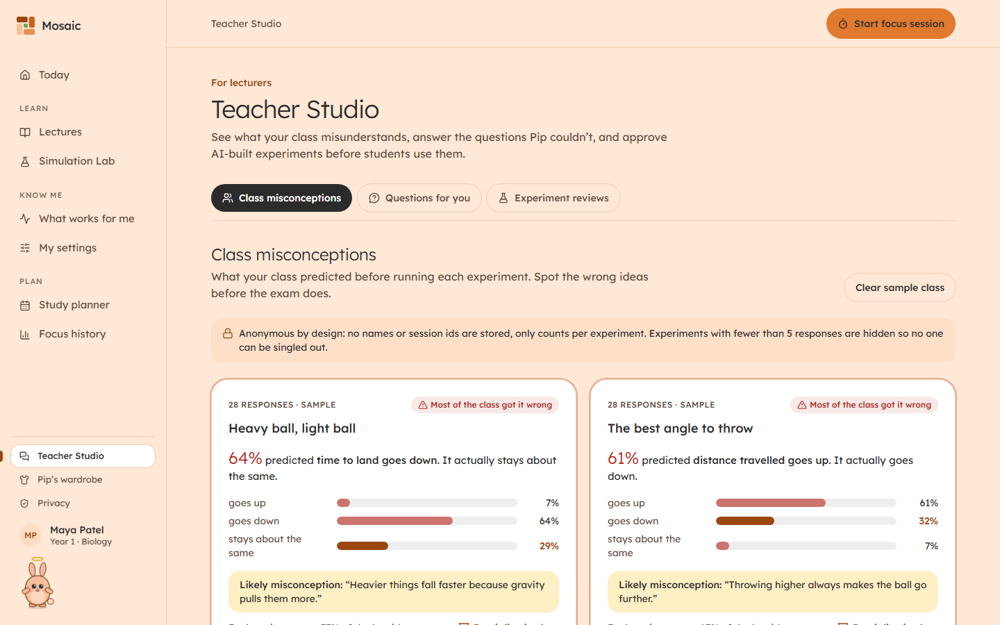
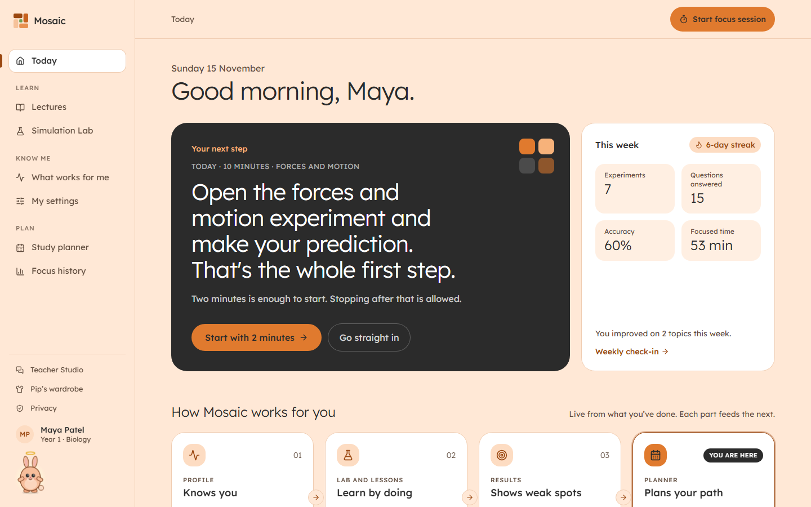
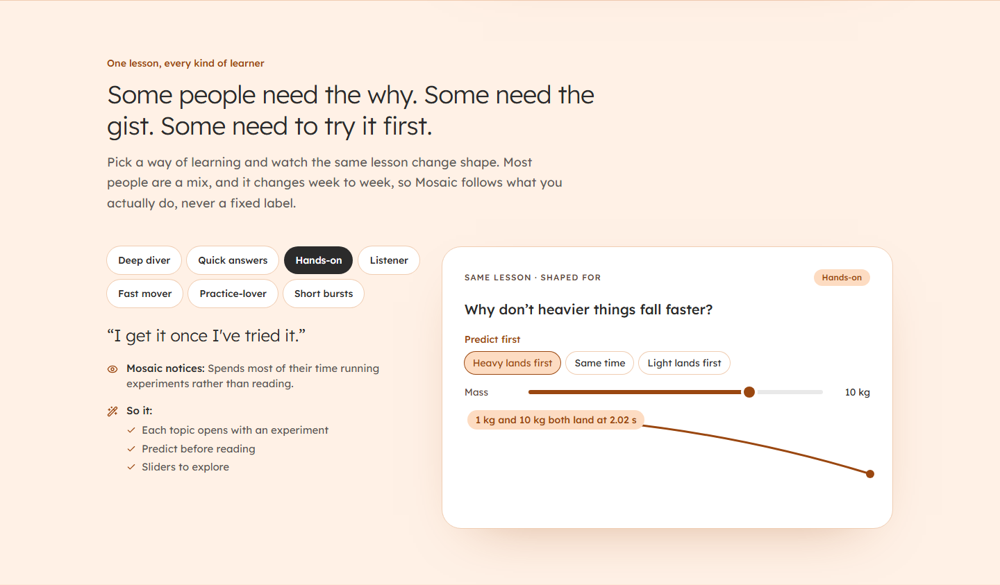
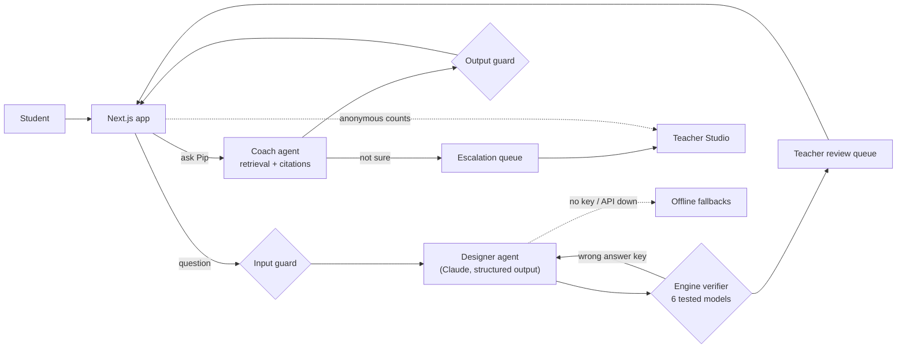

<div align="center">

# Mosaic

### Every lesson, shaped for the way you learn.

**An AI study companion that teaches by doing, learns how you study from what you actually do,
and plans your path to the exam, with teachers kept in the loop.**

Built for **Reply Student Tech Clash 2026 · AI on Campus (London)**




</div>

---

## The problem

Every student learns differently. Some need the *why*, some need the gist, some only get it once
they've tried it, some would rather listen. Most study tools still teach everyone the same way,
from the same wall of text, and nobody notices a misconception until the exam does.

AI tools made this faster, not better: they summarise your notes, but they don't **teach**, they
don't **know you**, and they can make things up.

## What Mosaic does

| | |
|---|---|
| 🧪 **Learn by doing** | Ask any science question and an AI agent builds an experiment for it: predict, run, explain. Six tested physics, chemistry and biology models with live canvas scenes: a cannon game on the Moon, a particle chamber, a predator–prey meadow. |
| 🌱 **Knows you, without labels** | Mosaic watches what you *do* (focus span, skimming, depth, practice, weak topics) and finds your learning mix: deep diver, quick answers, hands-on, listener… Every finding shows its evidence. It never diagnoses. |
| 🐣 **Pip, the Socratic coach** | Answers only from your lecture, cites the slide, gives hints instead of answers, and pauses for your lecturer when it isn't sure. Friendly, funny or 🎮 quest mode. |
| 📅 **Plans your path** | Add exam dates; get a plan sized to your real focus span with extra time on weak topics, a 2-minute "tiny first step" for procrastinators, and a weekly check-in. |
| 👩‍🏫 **Teacher Studio** | Anonymous class misconceptions ("64% predicted the heavy ball lands first"), questions Pip escalated, and a review queue to approve, edit or reject AI-built experiments before students see them. |

<table>
<tr>
<td width="50%"><br><sub>Drag to aim. Physics from a tested model, on any planet.</sub></td>
<td width="50%"><br><sub>Collision success follows the real Arrhenius equation.</sub></td>
</tr>
<tr>
<td><br><sub>Pip cites the slide, hints instead of answering, earns XP.</sub></td>
<td><br><sub>Anonymous misconceptions; groups under 5 hidden.</sub></td>
</tr>
<tr>
<td><br><sub>One next step, and the loop that connects everything.</sub></td>
<td><br><sub>The same lesson, shaped for seven learning patterns.</sub></td>
</tr>
</table>

## How it meets the brief

| Brief asks for | In Mosaic |
|---|---|
| A real learning problem, "start with the problem" | One-size-fits-all teaching, and misconceptions found too late |
| **L2** Live interaction loop, domain logic, state | Predict → run → explain on tested models; profile → lesson → results → plan loop |
| **L2** Real-time streaming UI | Pip streams replies; the experiment builder streams each agent step live (SSE) |
| **L2** Guardrails against hallucination and prompt injection | Input guard; retrieval grounding with citation checks; the engine verifies every AI answer key; output guard; "student text is data" |
| **L2** Session tracking, clear API contracts, modular backend | Per-tab session ids, agent log, [documented API](docs/api.md), small modules with tests |
| **L2** Production-minded | Error handling and offline fallbacks everywhere, rate limits, `.env.example`, 183 unit + 44 browser tests |
| **L3** Multi-agent | Designer agent → engine verifier (sends work back) → teacher; coach agent with its own guards; MCP server |
| **L3** Dynamic adaptation | Learning patterns reshape explanations ("key ideas first" vs "go deeper"), plans and Pip's replies |
| **L3** Human-in-the-loop | Checkpointed pauses on high-stakes, ambiguous, circular or low-confidence questions; teachers answer, override or resume; approval gate for AI experiments |
| Name the risks | Data stays on the device (export/delete), consent for under-18s, offline mode for outages before exams, no diagnosis ever |

More: [architecture and guardrails](docs/architecture.md) · [API contract](docs/api.md) ·
[decision log](docs/DECISIONS.md) · [3-minute demo script](docs/demo-script.md) ·
[feature notes](docs/features.md)

## Architecture



## Run it

```bash
npm install
cp .env.example .env.local    # optional: ANTHROPIC_API_KEY=… for live AI
npm run dev                   # http://localhost:3000
```

Without a key everything still works offline: experiments fall back to the closest ready-made
one and Pip answers straight from the slides. Set `MOSAIC_AI=off` to force offline mode on stage.

| Command | What it does |
|---|---|
| `npm run check` | Typecheck, lint and unit tests |
| `npm run test:e2e` | 44 browser journeys (Playwright) |
| `npm run mcp` | The Simulation Lab as an MCP server (stdio) |

## Project layout

```
app/                 pages and API routes (api/sim, api/coach, api/teacher, api/class)
components/          UI: sim/ (lab + live scenes), coach/ (Pip), teacher/, home/, landing/, lecture/, pip/
lib/
  sim/               simulation engine: templates (models), spec checks, library, share links
  ai/                designer agent, prompts, input guard, Claude client, agent log, rate limit
  coach/             Pip's retrieval, prompt, output guard
  learner/           event log, behaviour-based profile, learning patterns
  planner/           exam planner, habit coach, weekly check-in
  teacher/           class insights, review and escalation stores, human-review triggers
mcp/                 MCP server
e2e/                 Playwright journeys
docs/                architecture, API, decisions, design, demo script, screenshots
```

## Privacy and safety

- **Never diagnoses.** No condition labels anywhere; every AI prompt carries the rule, and an output guard replaces any reply that breaks it.
- **The student owns their data.** Profile, events and plans live in the browser; `/privacy` downloads or deletes everything.
- **Consent first.** Under-18s confirm a parent or guardian agrees before using the app.
- **Only what's needed reaches the AI:** the question, the retrieved course text, and the student's explanation. Never names, profiles or plans.
- **Teachers see the class, not the child.** Counts only, and groups under 5 are hidden.

> Demo limits: teacher routes aren't role-authenticated and teacher data lives in server memory.
> Production needs school sign-in and a database.

## Team

Built at AI on Campus London 2026 by Abhinav Nair, Ana, Jasmine Barry and team.
