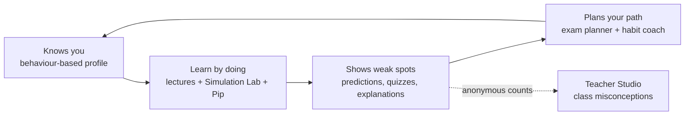
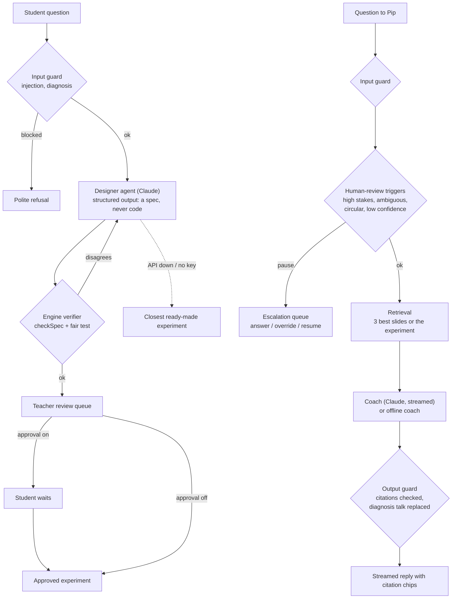

# Architecture

Mosaic is one Next.js app (App Router, TypeScript). The browser holds each student's own data;
the server runs the AI agents, the guardrails and the class-level teacher data.

## The learning loop

## Agents and guardrails

Every step writes to the agent log (`lib/ai/log.ts`) with the tab's session id, which the Teacher
Studio shows next to each escalation.

## Where things live

| Area | Code |
|---|---|
| Simulation engine (6 tested models) | `lib/sim/templates.ts`, `lib/sim/spec.ts`, `lib/sim/library.ts` |
| Live canvas scenes | `components/sim/scenes/` |
| Designer agent, prompts, input guard | `lib/ai/` |
| Pip the coach | `lib/coach/`, `components/coach/`, `app/api/coach/` |
| Learning profile and patterns | `lib/learner/` |
| Planner, habit coach, check-in | `lib/planner/` |
| Teacher Studio | `lib/teacher/`, `components/teacher/`, `app/api/teacher/` |
| MCP server | `mcp/server.ts`, `lib/mcp/tools.ts` |
| Consent and privacy | `lib/privacy.ts`, `components/consent-gate.tsx`, `app/privacy/` |
| Lectures, focus sessions, Pip's body | `components/lecture/`, `lib/screentime/`, `components/pip/` |

## Data

| Data | Where | Why |
|---|---|---|
| Profile, learning events, plans, consent | Browser `localStorage` | The student owns it; download and delete on `/privacy` |
| Agent log, escalations, reviews, class counts | Server memory | Demo; production needs a database and teacher sign-in |
| What reaches Anthropic | Only the question, the retrieved course text and the explanation | Never names, profiles or plans |

## Failure modes, by design

| If… | Then… |
|---|---|
| No API key, `MOSAIC_AI=off`, or the API is down | Experiments fall back to the closest ready-made one; Pip answers from the slides |
| The AI writes a wrong answer key | The engine catches it and sends it back (up to 3 tries) |
| The AI cites a source that doesn't exist | The citation is dropped before the student sees it |
| A question needs a human | The coach pauses with a checkpoint; the teacher answers, overrides or resumes |
| A class group is tiny | It is hidden (fewer than 5 responses) |
